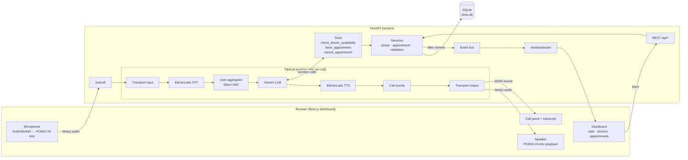
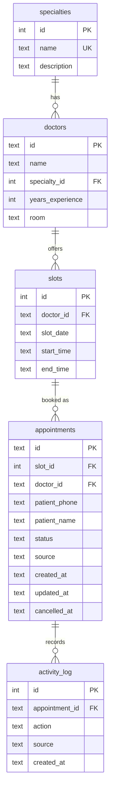

# Voice AI Doctor Appointment Assistant

A real-time **voice receptionist** for a (fictional) clinic. A caller talks to "Maya" from the browser, and Maya checks doctor availability, books appointments and cancels them. A live dashboard shows doctors, slots and appointments, and it updates the moment a booking or cancellation is saved.

> SDE Intern Round 1 assignment. Built with **Pipecat**, **ElevenLabs** (STT + TTS), **Google Gemini** (LLM with function calling), **FastAPI**, **SQLite**, **Next.js + TypeScript + Tailwind CSS**.

---

## 1. Project overview

| | |
|---|---|
| **What it does** | Lets callers book, check and cancel doctor appointments by voice |
| **Voice pipeline** | Browser mic → ElevenLabs STT → Gemini (+3 tools) → ElevenLabs TTS → browser speaker, orchestrated by Pipecat |
| **Data** | SQLite with doctors, specialties, slots, appointments and an activity log |
| **Identity** | The caller is identified **only by the phone number they speak**. The number is read back and confirmed before any booking or cancellation. There is no login, OTP or caller ID. |
| **UI** | Healthcare SaaS-style dashboard with a phone-style call panel and a live transcript |

## 2. Features

**Required**
- A real Pipecat voice pipeline: ElevenLabs Speech-to-Text → Gemini → ElevenLabs Text-to-Speech, streamed over a WebSocket.
- Three function tools registered with the LLM under these exact names: `check_doctor_availability`, `book_appointment` and `cancel_appointment`.
- The phone number is the only identity. It is read back digit by digit and confirmed. **The tools enforce this in code**, not only in the prompt.
- Double booking is blocked twice: an atomic check inside a `BEGIN IMMEDIATE` transaction, and a partial `UNIQUE` index on active appointments in the database.
- Seeded fictional data: 9 doctors, 8 specialties, about 300 slots over 14 days, some slots already booked, and demo appointments for testing cancellation.
- Dashboard sections:
  - overview stats
  - booking activity chart
  - doctors with an availability indicator
  - appointments with masked phone numbers
  - the voice call panel
- Live dashboard updates over a WebSocket. Changed rows are highlighted.

**Bonus features**
- Phone-style call UI with ringing, connecting, connected, ended and failed states.
- Call timer, mute/unmute and end-call controls.
- Animated waveform driven by real audio levels.
- Live transcript that streams the agent's words as they are spoken, plus a booking/cancellation confirmation card.
- **Silero VAD** turn detection, plus Pipecat's default *Smart Turn* end-of-turn model.
- Barge-in: when the caller interrupts, queued agent audio is flushed in the browser.
- Clear error reporting when a service fails, e.g. "the speech-to-text (ElevenLabs) service stopped working". The call ends cleanly instead of crashing.
- **Development mock mode** for running without API keys. See [§17](#17-mock-mode-and-its-limitations).

## 3. Technology stack

| Layer | Technology | Version |
|---|---|---|
| Voice orchestration | Pipecat (`pipecat-ai[google,elevenlabs,silero,websocket]`) | 1.17.0 |
| Speech-to-Text | ElevenLabs Scribe Realtime (`scribe_v2_realtime`) via `ElevenLabsRealtimeSTTService` | — |
| LLM | Google Gemini via `GoogleLLMService` (model configurable, default = Pipecat's default) | google-genai 3.6 |
| Text-to-Speech | ElevenLabs Flash v2.5 via `ElevenLabsTTSService` (streaming WebSocket) | — |
| VAD | Silero VAD (`SileroVADAnalyzer`) | — |
| Backend | Python 3.11, FastAPI, Uvicorn, pydantic-settings | FastAPI 0.165 |
| Database | SQLite (stdlib `sqlite3`, WAL mode) | — |
| Frontend | Next.js (App Router), React, TypeScript, Tailwind CSS v4, lucide-react | Next 16.4, React 19.3 |
| Tests | pytest + pytest-asyncio, Vitest + Testing Library | pytest 9.2, Vitest 5.1 |

## 4. Architecture



More detail is in [docs/ARCHITECTURE.md](docs/ARCHITECTURE.md).

## 5. Voice pipeline

Each call is one WebSocket (`/ws/call`) and one Pipecat `PipelineWorker` ([backend/app/voice/pipeline.py](backend/app/voice/pipeline.py)):

```
transport.input()  →  ElevenLabs STT  →  TranscriptTap  →  user aggregator (Silero VAD)
   →  Gemini LLM (+ tools)  →  ElevenLabs TTS  →  CallEventProcessor  →  transport.output()
   →  assistant aggregator
```

1. **Audio in.** An `AudioWorklet` downsamples the microphone to 16 kHz mono PCM16 and sends 20 ms binary frames.
2. **Transport.** `FastAPIWebsocketTransport` with a small custom serializer ([serializer.py](backend/app/voice/serializer.py)): binary frames carry audio and text frames carry JSON. It also checks the connection's `Origin` against the CORS allow-list.
3. **STT.** ElevenLabs realtime STT streams interim transcripts to the UI and produces the final transcript.
4. **Turn detection.** Silero VAD and Pipecat's turn strategy decide when the caller has finished speaking. The aggregator then adds the turn to the shared `LLMContext`.
5. **LLM.** Gemini receives the system prompt ([prompts.py](backend/app/voice/prompts.py)), the conversation and the three tool schemas, then either replies or calls a tool.
6. **TTS.** ElevenLabs streams synthesized audio (24 kHz PCM16) back over the socket. Word-level `TTSTextFrame`s drive the live transcript.
7. **Interruptions.** If the caller speaks over the agent, Pipecat emits an `InterruptionFrame`. It is serialized as `{"type":"interrupt"}` and the browser flushes queued audio.

## 6. Tool / function calling

The tools live in [backend/app/voice/tools.py](backend/app/voice/tools.py). `ClinicTools` is plain Python, so it can be unit-tested and the mock agent can reuse it. `register_tools()` registers each tool with `llm.register_function(name, handler, timeout_secs=…)`.

| Tool | Inputs | Result `status` values |
|---|---|---|
| `check_doctor_availability` | `date` (required), `doctor_name` / `doctor_id` / `specialty` | `available`, `no_availability` (+ `next_available_dates`), `no_matching_doctor`, `invalid_date`, `past_date` |
| `book_appointment` | `doctor_id`, `slot_id` (or `date` + `start_time`), `patient_phone`, `phone_confirmed`, `patient_name?`, `reason?` | `confirmation_required` (+ `phone_readback`), `booked` (+ real appointment ID), `slot_unavailable` (+ `alternative_slots`), `invalid_phone`, … |
| `cancel_appointment` | `patient_phone`, `phone_confirmed`, `appointment_id?`, `confirm_cancellation?` | `confirmation_required`, `multiple_found`, `confirm_cancellation_required`, `cancelled`, `no_appointments`, `appointment_not_found` |

**Server-enforced confirmation.** The first call with a phone number always returns `confirmation_required` and a digit-by-digit read-back. A booking or cancellation only goes through on a later call with `phone_confirmed=true` and the **same number** in the same call session. Cancelling needs one more step: the agent must first describe the exact appointment (`confirm_cancellation_required`) before `confirm_cancellation=true` works. Even an LLM that tries to skip steps cannot book or cancel without the read-back.

The agent only says "booked" when the tool returns `status: "booked"`. That only happens after the database insert has committed.

## 7. Database schema

Defined in [backend/app/models/schema.sql](backend/app/models/schema.sql). It is applied on every start-up and is idempotent.



Integrity rules enforced by the database:
- `UNIQUE INDEX ux_appointments_active_slot ON appointments(slot_id) WHERE status='booked'`. This allows only one active booking per slot, and a cancelled slot can be booked again.
- `CHECK (status IN ('booked','cancelled'))`
- `CHECK ((status='cancelled') = (cancelled_at IS NOT NULL))`. Cancellation timestamps stay consistent with the status.
- `UNIQUE(doctor_id, slot_date, start_time)` on slots, plus foreign keys (with `PRAGMA foreign_keys=ON`).
- Appointment IDs look like `APT-7K3Q9M`. They avoid 0/O and 1/I because they are read aloud.

## 8. Project structure

```
Voice AI Doctor/
├── backend/
│   ├── app/
│   │   ├── main.py              FastAPI app, exception handlers, /ws/call, /ws/dashboard
│   │   ├── config.py            env-based settings, live/mock mode selection
│   │   ├── database.py          connections, transactions, idempotent init
│   │   ├── models/schema.sql    tables, constraints, indexes
│   │   ├── schemas/api.py       Pydantic request models
│   │   ├── api/routes.py        REST endpoints
│   │   ├── services/            doctor_service, appointment_service, validation, events, clock, errors
│   │   ├── voice/
│   │   │   ├── pipeline.py      Pipecat pipeline (STT → LLM → TTS)
│   │   │   ├── agent.py         chooses live pipeline vs mock agent per call
│   │   │   ├── tools.py         the 3 function tools + Pipecat registration
│   │   │   ├── prompts.py       receptionist system prompt
│   │   │   ├── serializer.py    browser ⇄ Pipecat wire protocol
│   │   │   └── mock_agent.py    keyless, text-only development mock
│   │   └── data/                seed.py, reset.py, clinic.db (git-ignored)
│   ├── tests/                   83 pytest tests
│   ├── requirements.txt / requirements-dev.txt / .env.example
├── frontend/
│   ├── app/                     layout, page, globals.css
│   ├── components/              Dashboard, dashboard/*, call/*, ui/*
│   ├── hooks/                   useVoiceCall, useDashboardData
│   ├── lib/                     api, audio (mic + player), callReducer, format
│   ├── public/worklets/         mic-processor.js (AudioWorklet)
│   ├── types/                   API + call-protocol types
│   └── tests/                   20 Vitest tests
├── docs/                        ARCHITECTURE, PIPELINE_DESCRIPTION, DEMO_SCRIPT, FINAL_TEST_REPORT, IMPLEMENTATION_CHECKLIST
└── README.md
```

## 9. Installation

Prerequisites: **Python 3.11**, **Node.js 20+** (tested on 22.19), npm. Use Chrome or Edge for microphone access on `localhost`.

```powershell
# Backend
cd backend
python -m venv .venv
.venv\Scripts\python -m pip install -r requirements-dev.txt
copy .env.example .env      # then edit .env

# Frontend
cd ..\frontend
npm install
copy .env.example .env.local
```

## 10. Environment variables

`backend/.env` (template: [backend/.env.example](backend/.env.example)). Never commit `.env`.

| Variable | Purpose |
|---|---|
| `GOOGLE_API_KEY` | Gemini key from Google AI Studio |
| `GEMINI_MODEL` | Optional Gemini model name. Leave empty to use Pipecat's default; set one your key/quota allows |
| `ELEVENLABS_API_KEY` | ElevenLabs key (used for both STT and TTS) |
| `ELEVENLABS_VOICE_ID` | Voice used for TTS (default `21m00Tcm4TlvDq8ikWAM`) |
| `ELEVENLABS_TTS_MODEL` | Default `eleven_flash_v2_5` |
| `ELEVENLABS_STT_MODE` | `realtime` (streaming) or `batch` (one request per utterance, segmented by Silero VAD) |
| `VOICE_MODE` | `auto` (live if both keys are set, otherwise mock), `live`, or `mock` |
| `CLINIC_NAME`, `CLINIC_TIMEZONE` | Display name and the timezone used for "today" |
| `CORS_ORIGINS` | Allowed browser origins. Also enforced on the voice WebSocket |

`frontend/.env.local`: `NEXT_PUBLIC_API_URL=http://localhost:8000`. This is only the backend URL. The frontend never holds API keys.

## 11. Run the backend

```powershell
cd backend
.venv\Scripts\python -m uvicorn app.main:app --port 8000
```
On first start the server creates and seeds `app/data/clinic.db`. The log shows `voice_mode=live` or `voice_mode=mock`. `GET http://localhost:8000/api/health` reports the mode and any missing keys. To reset the demo data, run `.venv\Scripts\python -m app.data.reset`.

## 12. Run the frontend

```powershell
cd frontend
npm run dev
```
Open http://localhost:3000, click **Start call** and allow the microphone.

## 13. Testing

```powershell
cd backend;  .venv\Scripts\python -m pytest -q        # 83 tests
cd frontend; npm test                                 # 20 tests
cd frontend; npm run typecheck; npm run lint
```
The backend tests cover validation, the service layer (persistence, double booking, state transitions), the three tools (including server-enforced confirmation), the REST API, the dashboard WebSocket, and end-to-end call scenarios over the real `/ws/call` socket. They also check the wiring of the live Pipecat pipeline. See [docs/FINAL_TEST_REPORT.md](docs/FINAL_TEST_REPORT.md) for actual results.

## 14. Testing booking and cancellation manually

Demo phone numbers in the seed data (all fictional):

| Phone | Seeded state | Use it to test |
|---|---|---|
| `98765 00001` | 2 upcoming appointments (Dr. Rao, Dr. Thompson) | "Which one should I cancel?" |
| `98765 00002` | 1 upcoming appointment | simple cancellation |
| `98765 00003` | only a cancelled appointment | "no upcoming appointments" |
| any new 10-digit number | none | new booking |

Booking: *"I want to book an appointment with a cardiologist"* → give a date → choose an offered time → give a name → say your number → confirm.
Cancellation: *"I'd like to cancel my appointment"* → say `98765 00001` → confirm → choose one → confirm.
The full script is in [docs/DEMO_SCRIPT.md](docs/DEMO_SCRIPT.md).

## 15. LLM used

**Google Gemini** through Pipecat's `GoogleLLMService` (Google Gen AI SDK). It uses temperature 0.3, the receptionist system instruction, and native function calling. The model is set with `GEMINI_MODEL`. If it is empty, Pipecat 1.17's default Gemini model is used. Pick a model that is available on your key's free tier.

## 16. STT and TTS providers

- **STT:** ElevenLabs Scribe Realtime (`ElevenLabsRealtimeSTTService`, model `scribe_v2_realtime`, English). Commits are manual, so Pipecat's VAD decides when a segment ends. `ELEVENLABS_STT_MODE=batch` switches to the file-based `ElevenLabsSTTService` (`scribe_v2`).
- **TTS:** ElevenLabs streaming WebSocket TTS (`ElevenLabsTTSService`, model `eleven_flash_v2_5`), 24 kHz PCM.

## 17. Mock mode and its limitations

If either API key is missing, or `VOICE_MODE=mock`, calls use a **development mock** ([mock_agent.py](backend/app/voice/mock_agent.py)):
- It is **text only**: the caller types and the agent replies in text. There is no speech recognition, speech synthesis or LLM, and no external service is called.
- The replies come from a deterministic rule-based receptionist. It follows the same rules as the real agent (one question at a time, read-back and confirmation) and calls the **same `ClinicTools`** against the same database. Bookings made in mock mode are real database rows, so the dashboard updates the same way.
- It is clearly labelled in four places: the header badge, a banner in the call panel, "mock" on every agent message, and `"mock": true` in the protocol. Mock output is never presented as Gemini or ElevenLabs output.
- Limitations: it understands only common phrasings (doctor/specialty names, dates like "tomorrow" or "28 November", times like "10:30 am", digit or word phone numbers, yes/no). It is a testing aid and does not replace the LLM.

## 18. Design decisions

- **Rules live in code and in the database, not only in the prompt.** LLMs sometimes skip steps, so phone confirmation is enforced by the tools and double booking by a DB constraint.
- **One place that writes.** `appointment_service` is the only code that writes appointments. The REST API, the voice tools and the mock agent all use it.
- **Custom minimal wire protocol** (binary = PCM, text = JSON) instead of the RTVI client SDK. It is small enough to explain line by line and needs no extra frontend dependencies. RTVI is disabled (`enable_rtvi=False`).
- **Plain `sqlite3` with explicit SQL** instead of an ORM. The schema and constraints are visible in one file. `BEGIN IMMEDIATE` makes the check-then-insert atomic.
- **Availability is generated relative to today** (deterministic seed, `ensure_slot_horizon` on each start), so the demo always has upcoming slots.
- **Privacy.** Phone numbers are masked (`******0001`) and names reduced to initials in every API response. Logs mask phone numbers, and secrets are never logged.
- **Pure call reducer** in the frontend (`lib/callReducer.ts`). The call's state machine is unit-tested without browser APIs.

## 19. Known limitations

- The live Gemini/ElevenLabs path was verified up to the providers: with invalid keys, all three services were contacted and rejected the keys. It was **not** run with real keys in this environment, so speech quality, latency and the LLM's dialogue behaviour still need to be checked with your own keys. See the test report.
- English only. The clinic timezone is fixed by configuration.
- One clinic and a fixed 30-minute slot length. There is no doctor or admin editing UI.
- The browser needs microphone permission and a secure context (`localhost` or HTTPS).
- No authentication on the dashboard. It is meant for local demo use only.

## 20. Future improvements

- Telephony (Twilio/Plivo serializers already exist in Pipecat) so people can call a real phone number.
- SMS confirmation of bookings, reminders and rescheduling (`reschedule_appointment`).
- Multilingual STT/TTS, and a fallback LLM via Pipecat's `LLMSwitcher`.
- Staff authentication and an admin UI for schedules. Postgres for multi-instance deployment.
- Recorded-conversation evaluations with Pipecat evals, and latency metrics on the dashboard.
