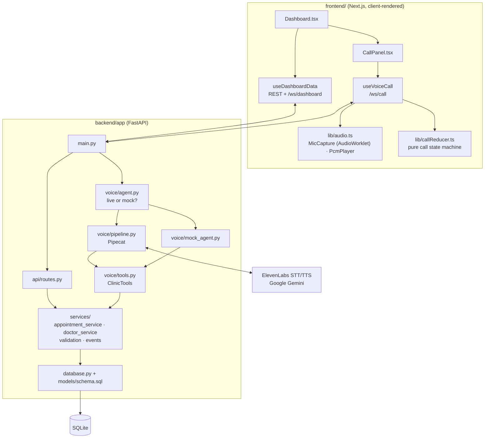
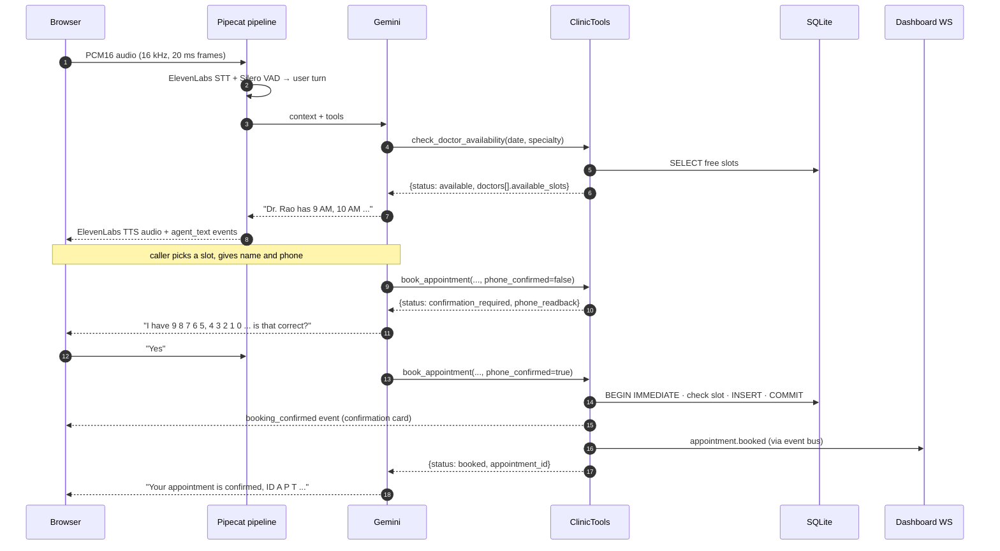

# Architecture

## Components

## Layering rules

| Layer | May call | Never |
|---|---|---|
| `api/routes.py` (HTTP) | services | SQL directly |
| `voice/tools.py` (LLM tools) | services | SQL directly, Pipecat internals (only via `register_tools`) |
| `services/*` | `database.py`, `events.bus` | FastAPI, Pipecat |
| `database.py` / `schema.sql` | — | business logic |

Because both the REST API and the voice tools go through `appointment_service`, they share one implementation of the booking rules.

## Call sequence (booking)

## Wire protocol (`/ws/call`)

| Direction | Frame | Content |
|---|---|---|
| browser → server | binary | PCM16 LE mono 16 kHz microphone audio |
| browser → server | text | `{"type":"end_call"}` · mock mode: `{"type":"user_text","text":…}` |
| server → browser | binary | PCM16 LE mono 24 kHz agent speech |
| server → browser | text | `call_state`, `transcript`, `agent_text`, `agent_state`, `user_state`, `interrupt`, `tool_call`, `tool_result`, `booking_confirmed`, `cancellation_confirmed`, `error` |

## Concurrency and consistency

- Each call has its own pipeline and its own `ClinicTools` (per-call confirmation state). Calls do not share any state except the database.
- Tool handlers run their SQLite work with `asyncio.to_thread` so the audio pipeline is never blocked.
- `BEGIN IMMEDIATE` serialises writers. If two callers race for the same slot, one wins. The other gets `slot_unavailable` and alternative slots, and the partial unique index guarantees this even if the code were bypassed.
- The event bus publishes **after commit**, so the dashboard never shows an uncommitted booking.

## Failure handling

| Failure | Behaviour |
|---|---|
| Missing API keys | `auto` mode falls back to the labelled mock; `live` mode refuses the call with a clear error |
| Provider rejects key / quota | `on_pipeline_error` → named error to UI once; if the processor is unusable the call ends cleanly; server keeps running |
| Tool exception | Caught in `ClinicTools.call` → `internal_error` result; the agent apologises |
| Tool hangs | `register_function(..., timeout_secs=10)` |
| Caller silent too long | `idle_timeout_secs` (120 s) cancels the pipeline |
| Very long call | `session_timeout` (600 s) |
| Browser closes tab | `on_client_disconnected` → `worker.cancel()` |
| Disallowed `Origin` | WebSocket rejected (1008) |
